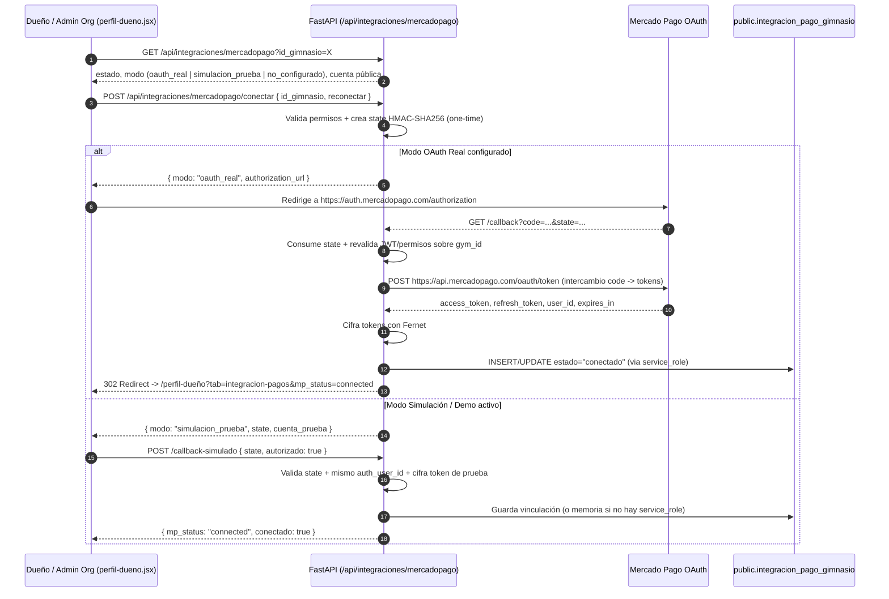

# GYMTRACK — Arquitectura Técnica de Mercado Pago

La integración de **Mercado Pago** en GymTrack se divide en **dos subsistemas complementarios** que cubren tanto la **vinculación segura de la cuenta cobradora del gimnasio (OAuth 2.0)** como la **generación de sesiones de cobro para los socios (Checkout Pro)**.

---

## 1. Mapa de Archivos de Mercado Pago

| Capa | Archivo | Responsabilidad |
| :--- | :--- | :--- |
| **Backend — Router OAuth** | [integraciones_pago.py](file:///C:/Users/lutra/OneDrive/Documentos/GitHub/gymtrack-backend-python/app/routers/integraciones_pago.py) | Endpoints `/api/integraciones/mercadopago/*`: consulta de estado, inicio de OAuth, callback oficial, callback simulado (demo) y desconexión. |
| **Backend — Servicio OAuth & Cifrado** | [mercadopago_oauth.py](file:///C:/Users/lutra/OneDrive/Documentos/GitHub/gymtrack-backend-python/app/services/mercadopago_oauth.py) | Validación de variables, generación/consumo de `state` HMAC-SHA256 anti-CSRF, intercambio de `code` por tokens en MP y cifrado/descifrado **Fernet**. |
| **Backend — Modelos OAuth** | [integracion_pago.py](file:///C:/Users/lutra/OneDrive/Documentos/GitHub/gymtrack-backend-python/app/models/integracion_pago.py) | Esquemas Pydantic estrictos (`extra="forbid"`): `IniciarConexionMPRequest`, `DesconectarMPRequest`, `CallbackSimuladoMPRequest`. |
| **Backend — Cobro al Socio** | [dashboard_socio.py](file:///C:/Users/lutra/OneDrive/Documentos/GitHub/gymtrack-backend-python/app/routers/dashboard_socio.py) | Endpoint `POST /api/socio/pagos/iniciar` y receptor `POST /api/socio/pagos/webhook`. |
| **Backend — Pasarela Checkout Pro** | [payment_service.py](file:///C:/Users/lutra/OneDrive/Documentos/GitHub/gymtrack-backend-python/app/services/payment_service.py) | `crear_preferencia_mercadopago()` para crear preferencias en `/checkout/preferences` (o modo `sandbox_simulado`) y generar QR. |
| **Frontend — Servicio OAuth** | [integracionPagoService.js](file:///c:/Users/lutra/OneDrive/Documentos/GitHub/GYMTRACK/frontend/src/services/integracionPagoService.js) | Consumo de `/api/integraciones/mercadopago/*` sin manejar jamás tokens OAuth en el navegador. |
| **Frontend — UI Dueño/Admin** | [perfil-dueno.jsx](file:///c:/Users/lutra/OneDrive/Documentos/GitHub/GYMTRACK/frontend/src/pages/perfil-dueno/perfil-dueno.jsx) | Pestaña `integracion-pagos`: muestra estado, inicia OAuth, maneja retorno `?mp_status=connected|error`, modal demo y desconexión. |
| **Frontend — Cobro Socio** | [socioMembresiaService.js](file:///c:/Users/lutra/OneDrive/Documentos/GitHub/GYMTRACK/frontend/src/services/socioMembresiaService.js) / [socio-membresia.jsx](file:///c:/Users/lutra/OneDrive/Documentos/GitHub/GYMTRACK/frontend/src/pages/membresia-socio/socio-membresia.jsx) | Inicia la orden de pago del plan (`iniciarPagoMembresia`), abre `init_point` y actualiza estado desde servidor. |

---

## 2. Subsistema 1: Vinculación de Cuenta por Gimnasio (OAuth 2.0)

### 2.1 Tabla privada y aislamiento de credenciales
Los tokens de Mercado Pago de cada gimnasio se persisten en la tabla `public.integracion_pago_gimnasio` con las columnas:
`id_integracion_pago`, `id_gimnasio`, `proveedor`, `external_user_id`, `access_token_encrypted`, `refresh_token_encrypted`, `token_expires_at`, `estado`, `fecha_conexion`, `fecha_actualizacion`.

Medidas de seguridad aplicadas:
- **Tabla privada sin permisos a `anon`/`authenticated`:** solo el servidor backend accede mediante `supabase_admin` (`SUPABASE_SERVICE_ROLE_KEY`), y únicamente **después** de autenticar al usuario con su JWT y validar con `verify_dueno_or_org_admin_of_gimnasio()` que es **Dueño** o **Administrador Organizacional** del gimnasio.
- **Sanitización estricta (`INTEGRACION_PUBLIC_COLUMNS`):** las consultas de lectura omiten `access_token_encrypted` y `refresh_token_encrypted`. La función `_sanitize_public_integration()` nunca devuelve tokens al frontend ni los imprime en logs.
- **Unicidad por gimnasio:** no permite conectar una segunda cuenta si el gimnasio ya tiene una en estado conectado (`409 Conflict`), salvo que se envíe explícitamente `reconectar: true`.

### 2.2 Cifrado en reposo con Fernet
En [mercadopago_oauth.py](file:///C:/Users/lutra/OneDrive/Documentos/GitHub/gymtrack-backend-python/app/services/mercadopago_oauth.py):
- `encrypt_oauth_token()` y `decrypt_oauth_token()` utilizan `cryptography.fernet.Fernet` (**AES-128 en modo CBC con padding PKCS7 + autenticación HMAC-SHA256**) usando la variable privada `MERCADOPAGO_TOKEN_ENCRYPTION_KEY` (32 bytes en base64 url-safe).
- Tanto `access_token` como `refresh_token` se cifran antes de ejecutarse el `INSERT`/`UPDATE` en `public.integracion_pago_gimnasio`.

### 2.3 Protección anti-CSRF y anti-Replay (`state` firmado)
Al iniciar la conexión (`create_oauth_state`):
1. Se genera un `nonce` aleatorio criptográfico (`secrets.token_urlsafe(24)`) y un timestamp `ts`.
2. Se calcula una firma HMAC-SHA256 sobre `"{nonce}.{ts}.{gym_id}.{auth_user_id}"` usando `MERCADOPAGO_STATE_SECRET` (o una clave derivada por dominio desde `MERCADOPAGO_TOKEN_ENCRYPTION_KEY`).
3. El parámetro `state` resultante (`"{nonce}.{ts}.{gym_id}.{sig}"`) se guarda en memoria (`_OAUTH_PENDING_STATES`) protegido por lock (`threading.Lock`) con un **TTL de 10 minutos** (`_OAUTH_STATE_TTL_SECONDS = 600`) y asociado al `auth_user_id`, `id_gimnasio` y `user_access_token`.
4. En el callback, `consume_and_validate_oauth_state()` extrae y **elimina** el registro del diccionario (`pop`, garantizando **un solo uso / anti-replay**), verifica expiración, coincidencia de `id_gimnasio` y compara la firma en tiempo constante con `hmac.compare_digest()`.

### 2.4 Flujo completo de endpoints OAuth



- **Desconexión (`POST /api/integraciones/mercadopago/desconectar` o `DELETE /api/integraciones/mercadopago`):**
  Limpia `access_token_encrypted = None`, `refresh_token_encrypted = None`, `token_expires_at = None` y actualiza `estado = "desconectado"`. **Nunca elimina ni altera los registros históricos de `public.pago`**.

### 2.5 Modo real vs. Modo demo (`MERCADOPAGO_OAUTH_DEMO_MODE`)
- Si están configuradas y válidas las 4 variables (`MERCADOPAGO_CLIENT_ID`, `MERCADOPAGO_CLIENT_SECRET`, `MERCADOPAGO_REDIRECT_URI` y `MERCADOPAGO_TOKEN_ENCRYPTION_KEY`), el sistema opera en `modo = "oauth_real"`.
- Si no están configuradas las credenciales OAuth de aplicación pero sí existe `MERCADOPAGO_ACCESS_TOKEN` o `MP_VENDEDOR_USER_ID` (salvo que `MERCADOPAGO_OAUTH_DEMO_MODE=false`), habilita `simulacion_prueba` para presentaciones y desarrollo local.
- Si tampoco está en modo demo, `require_mercadopago_oauth_configured()` devuelve `503 Service Unavailable` indicando exactamente qué variables privadas faltan o son inválidas (sin revelar valores secretos).

---

## 3. Subsistema 2: Checkout Pro para Pagos de Socios

### 3.1 Preparación de la orden (`POST /api/socio/pagos/iniciar`)
Implementado en [dashboard_socio.py](file:///C:/Users/lutra/OneDrive/Documentos/GitHub/gymtrack-backend-python/app/routers/dashboard_socio.py) con el esquema `IniciarPagoSocio` (`id_membresia_gimnasio`, `proveedor="mercadopago"`):

1. Verifica que el usuario autenticado tenga perfil de `socio` y que el plan seleccionado en `public.membresia_gimnasio` exista y esté activo (`estado == True`).
2. Comprueba que el socio tenga una asociación activa (`public.socio_gimnasio.estado == True`) en el gimnasio dueño del plan (`403 Forbidden` si no).
3. **Integridad de precios:** toma el importe **directamente de la base de datos** (`monto_real = round(float(plan["precio"]), 2)`), nunca desde el request del navegador.
4. Genera un identificador único de trazabilidad (`external_reference`):
   ```text
   GYM-{id_gimnasio}-SOC-{id_socio}-PL-{id_membresia_gimnasio}-{timestamp}
   ```
5. Llama a `crear_preferencia_mercadopago()` en [payment_service.py](file:///C:/Users/lutra/OneDrive/Documentos/GitHub/gymtrack-backend-python/app/services/payment_service.py).

### 3.2 Creación de la Preferencia en Mercado Pago (`payment_service.py`)
1. **Modo API Real (`MERCADOPAGO_ACCESS_TOKEN` con prefijo `APP_USR-`):**
   Envía `POST https://api.mercadopago.com/checkout/preferences` mediante `httpx.AsyncClient` con:
   - `items`: título (`"{titulo} - {gym_nombre}"`), descripción, `quantity: 1`, `currency_id: "ARS"`, `unit_price: precio_unitario`.
   - `payer`: `name`, `surname`, `email`, `identification: { type: "DNI", number: socio_dni }`.
   - `external_reference`: clave única de correlación.
   - `back_urls`:
     - `success`: `${FRONTEND_URL}/membresia-socio?pago_status=approved&ref=${external_reference}`
     - `pending`: `${FRONTEND_URL}/membresia-socio?pago_status=pending&ref=${external_reference}`
     - `failure`: `${FRONTEND_URL}/membresia-socio?pago_status=rejected&ref=${external_reference}`
   - Respuesta devuelta al frontend: `proveedor`, `modo: "api_real"`, `id_preferencia`, `init_point`, `sandbox_init_point`, `external_reference`, `monto` y `qr_codigo` (URL de QR codificando `init_point`).
2. **Modo Fallback (`sandbox_simulado`):**
   Si no hay `APP_USR-...` configurado o falla la petición a la API en vivo, genera una preferencia simulada (`MP-PREF-{ms}-{rand}`), una URL local (`${FRONTEND_URL}/membresia-socio?checkout=mercadopago&ref=...&pref=...&monto=...`) y su `qr_codigo`.

### 3.3 Flujo en el Portal del Socio y Webhook
- En [socio-membresia.jsx](file:///c:/Users/lutra/OneDrive/Documentos/GitHub/GYMTRACK/frontend/src/pages/membresia-socio/socio-membresia.jsx), al hacer clic en pagar:
  - Se llama a `iniciarPagoMembresia({ id_membresia_gimnasio })`.
  - El frontend valida que la URL devuelta (`init_point` / `sandbox_init_point`) sea HTTP/HTTPS válida y la abre en una nueva pestaña (`window.open(..., '_blank', 'noopener,noreferrer')`).
  - **Regla de seguridad:** el cliente **nunca auto-acredita ni activa** una membresía al volver de la pasarela. Si el socio desea registrar una solicitud sin pago digital inmediato, puede usar `POST /api/socio/membresia/solicitar` que crea el contrato en estado `'pendiente'`.
- **Receptor de Webhook (`POST /api/socio/pagos/webhook`):**
  En [dashboard_socio.py](file:///C:/Users/lutra/OneDrive/Documentos/GitHub/gymtrack-backend-python/app/routers/dashboard_socio.py), existe el receptor `webhook_pago` que responde `200 OK` con `{ recibido: True, proveedor, requiere_verificacion_firma: True, evento_detectado: ... }`. Está diseñado explícitamente para **no acreditar pagos automáticamente hasta implementar la verificación de firma HMAC** del webhook.

---

## 4. Observaciones Técnicas del Estado Actual del Código

1. **Desacoplamiento actual entre OAuth por gimnasio y `payment_service.py`:**
   - El subsistema OAuth ya cifra, guarda (`encrypt_oauth_token`) y expone el helper `decrypt_oauth_token()` en [mercadopago_oauth.py](file:///C:/Users/lutra/OneDrive/Documentos/GitHub/gymtrack-backend-python/app/services/mercadopago_oauth.py).
   - Sin embargo, `crear_preferencia_mercadopago()` en [payment_service.py](file:///C:/Users/lutra/OneDrive/Documentos/GitHub/gymtrack-backend-python/app/services/payment_service.py) todavía lee el token global `MERCADOPAGO_ACCESS_TOKEN` de las variables de entorno en lugar de consultar y descifrar el `access_token_encrypted` del gimnasio en `public.integracion_pago_gimnasio`.
2. **Acreditación automática en Python vs. legado Node.js:**
   - En el backend legacy de Node.js ([socioMembresiaController.js](file:///c:/Users/lutra/OneDrive/Documentos/GitHub/GYMTRACK/backend/src/controllers/socioMembresiaController.js)) existían funciones como `confirmarPago` y `verificarPagoMercadoPago`.
   - En el backend activo de Python ([dashboard_socio.py](file:///C:/Users/lutra/OneDrive/Documentos/GitHub/gymtrack-backend-python/app/routers/dashboard_socio.py)), se eliminó la auto-confirmación insegura desde el cliente (`confirmarPago`) y `webhook_pago` deja pendiente la validación de firma HMAC antes de invocar `rpc_contratar_membresia` / `rpc_registrar_pago`.
